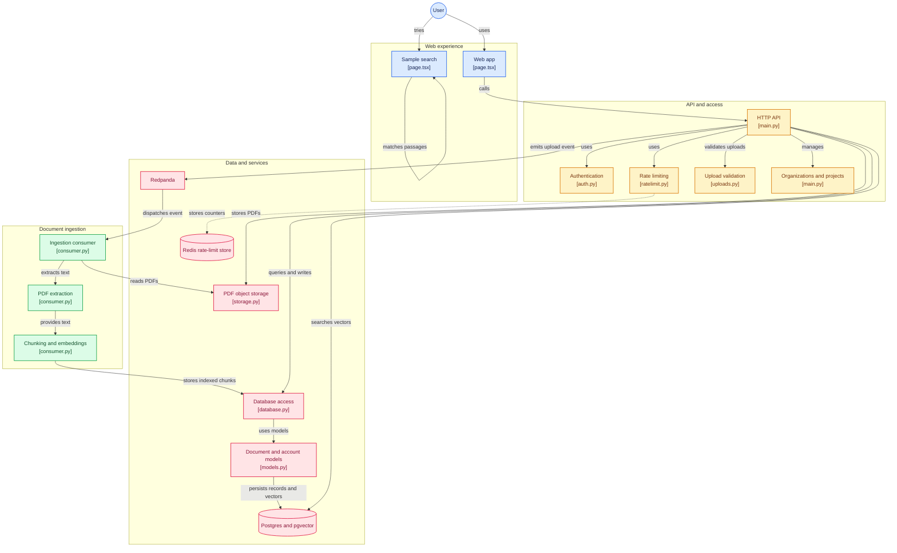

# AtlasOps

Open-source, self-hostable AI document intelligence platform. Upload a document corpus, index it with semantic embeddings, and query it in natural language — all running on your own infrastructure, with no data leaving your network.

## Live Demo

[Try the live demo](https://atlasops-psi.vercel.app).

<table>
  <tr>
    <td></td>
    <td></td>
  </tr>
</table>

The Vercel demo runs without a backend: try the interactive search over bundled sample passages.
It does not upload documents or call an AI service. The full application stack is built with
FastAPI, Redpanda, Postgres/pgvector, Next.js, and Gemini for the planned AI question-answering
flow.

The backend includes authentication, rate limits, PDF and upload-size validation, and
loopback-only Compose port bindings. These safeguards are part of the self-hosted backend; they
are not exercised by the frontend-only demo.

## What It Does

- Ingests PDFs into per-project corpora, stored in S3-compatible object storage
- Extracts text, chunks it with overlap, and generates 384-dimensional vector embeddings
- Indexes chunks in Postgres with the pgvector extension for cosine-similarity search
- Serves semantic search queries over HTTP with ranked results and similarity scores
- Uses an event-driven ingestion pipeline (Kafka-compatible Redpanda) so upload and indexing are decoupled

## Architecture

Upload and query are separate paths that share a Postgres + pgvector backend.



## Stack

| Component | Technology |
|---|---|
| API | Python 3, FastAPI, SQLAlchemy, Pydantic |
| Database | Postgres 16 + pgvector |
| Object storage | MinIO (S3-compatible) |
| Event bus | Redpanda (Kafka-compatible) |
| Cache | Redis 7 |
| Embeddings | SentenceTransformer (384-dim) |
| PDF parsing | PyPDF, 1000-char chunks, 200-char overlap |
| Frontend | Next.js |
| Testing | pytest + pytest-asyncio |
| Deployment | Docker Compose |

## Quickstart

Backing services run in Docker; the API runs locally against them.

```bash
git clone https://github.com/shepdogg6t7-glitch/atlasops-fullstack.git
cd atlasops-fullstack
cp .env.example .env             # edit values if needed
docker compose up -d             # Postgres, Redis, MinIO, Redpanda (ports bound to localhost)
python -m venv .venv && source .venv/bin/activate
pip install -r apps/api/requirements.txt
uvicorn apps.api.main:app --reload
```

The API is then available at http://localhost:8000. On first run,
the SentenceTransformer model downloads automatically (~90MB).

To run the web app in a second terminal:

```bash
cd apps/web
npm install
npm run dev
```

Open http://localhost:3000 to register/sign in, create a project, and upload documents.
Registration is enabled for local development by `.env.example`; set `ALLOW_REGISTRATION=false`
in `.env` to disable new account creation. The API defaults to denying registration when the
setting is unset. For a new deployment, temporarily enable registration to create the first
account, then disable it and restart the API. Registration is a public on/off switch, not an
invite-code system.

### Deploy the interactive demo on Vercel

Import this GitHub repository in Vercel and set the project **Root Directory** to `apps/web`;
Vercel will detect Next.js and use the existing build settings. The deployed page opens in demo
mode and searches bundled sample passages without an account or backend. Live sign-in and PDF
uploads require a publicly reachable AtlasOps API: set `NEXT_PUBLIC_API_BASE_URL` in the Vercel
project environment variables and configure that API's `CORS_ORIGIN` for the deployed Vercel
domain. Do not point a public deployment at `localhost`; that address refers to each visitor's
own device.

Uploads must be PDFs and are limited to 25 MB by default (`MAX_UPLOAD_MB`). Since the API checks
the file after multipart parsing, also configure a request-body limit on any reverse proxy.
Rate limits are enabled by default; the in-memory counter is per API process. Set
`RATE_LIMIT_STORAGE_URI` to a shared Redis URL when running multiple workers (for the local
quickstart, `redis://localhost:6379/0`). Rate limiting fails closed: if Redis is unavailable,
limited requests receive `503` until it recovers. Configure Uvicorn's proxy headers with only
your trusted proxy addresses when deployed behind a proxy.

## API Endpoints

- `POST /auth/register` — create an account and isolated organization; passwords must be at least 12 characters
- `POST /auth/login` — exchange email/password credentials for a 30-minute bearer token
- `GET /organizations` — list organizations belonging to the authenticated user
- `GET /organizations/{organization_id}/projects` — list projects in an organization the user belongs to
- `POST /organizations` and `POST /organizations/{organization_id}/projects` — create organizations/projects
- `POST /projects/{project_id}/documents` — upload a PDF; creates the document record and emits an ingestion event
- `GET /projects/{project_id}/documents` — list the authenticated user's documents in a project
- `POST /projects/{project_id}/search` — semantic search; returns top-N chunks with similarity scores

Every `/organizations` and `/projects` endpoint requires an `Authorization: Bearer <token>` header. Project access is checked against the authenticated user's organization membership. Set `JWT_SECRET` in `.env` to a randomly generated value of at least 32 characters before starting the API, for example:

```bash
python -c "import secrets; print(secrets.token_urlsafe(48))"
```

The API will not start or issue tokens when `JWT_SECRET` is missing or invalid; no development signing key is built in. The web app defaults to `http://localhost:8000` for the API. Set `NEXT_PUBLIC_API_BASE_URL` in the web process environment or `apps/web/.env.local` when the API uses a different address. Login state is held in memory and is cleared when the page reloads. Use HTTPS when exposing the API beyond a trusted local network.

See [MILESTONE_2.md](MILESTONE_2.md) for the full endpoint specification, request/response schemas, and usage examples.

## Testing

```bash
pytest
```

Test configuration is in `pytest.ini` (asyncio auto mode, tests under `apps/api/tests/`). A full verification report from the Milestone 2 review is in [VERIFICATION_REPORT.md](VERIFICATION_REPORT.md); the milestone-specific report is in [MILESTONE_2_VERIFICATION.md](MILESTONE_2_VERIFICATION.md).

## Project Status

- **Milestone 1** — Foundation: API, database schema, object storage, project and document models — done
- **Milestone 2** — Semantic search: pgvector indexing, embedding pipeline, ingestion worker, search endpoint — done
- **Milestone 3** — Planned

## Documentation

- [`docs/adr/`](docs/adr/) — architecture decision records
- [`docs/architecture/`](docs/architecture/) — system architecture notes
- [`docs/operations/`](docs/operations/) — operational runbooks
- [`docs/security/`](docs/security/) — security posture and threat model
- [`MILESTONE_2.md`](MILESTONE_2.md) — full Milestone 2 design and implementation
- [`examples/`](examples/) — sample documents and evaluation dataset

## License

Apache 2.0 — see [LICENSE](LICENSE).
